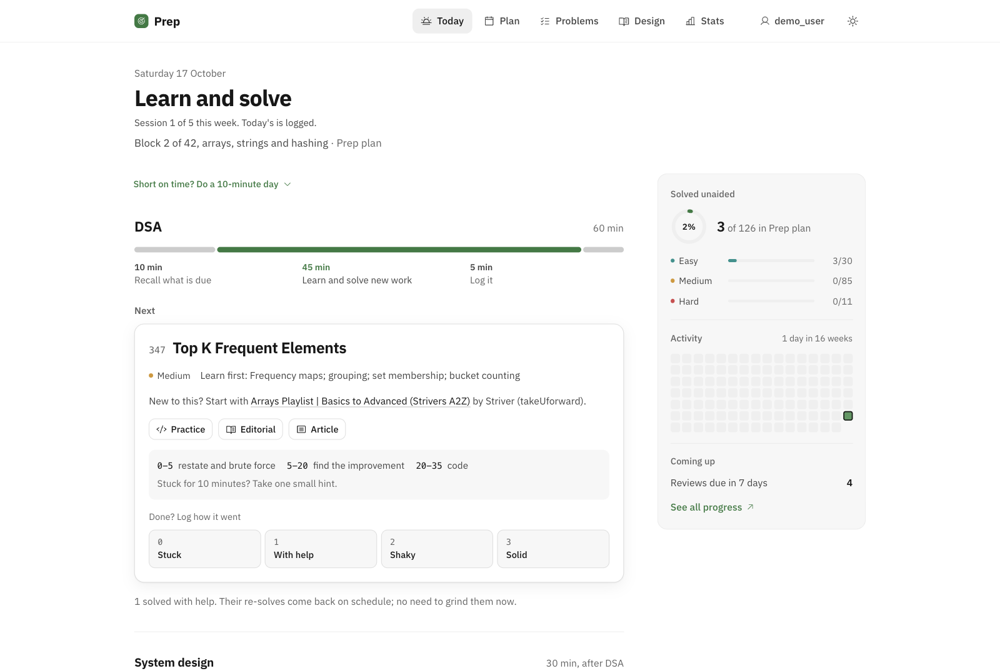
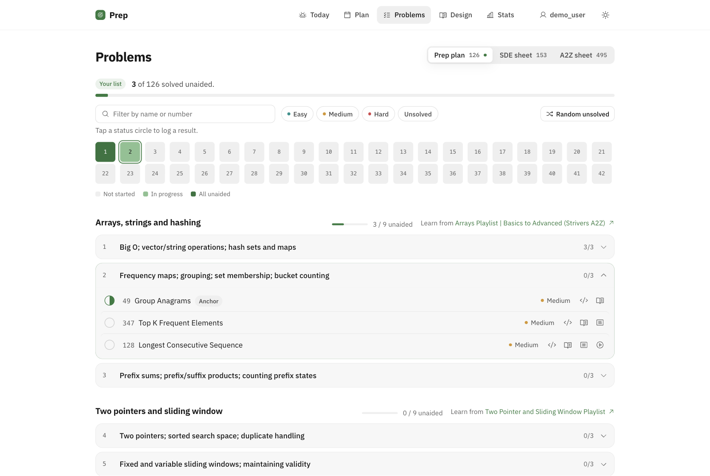
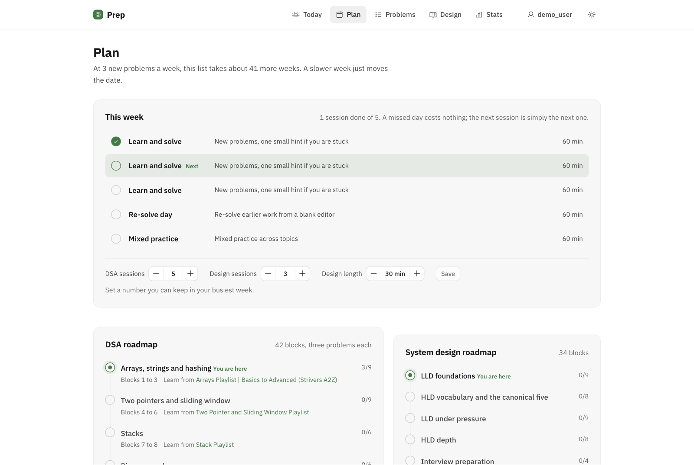
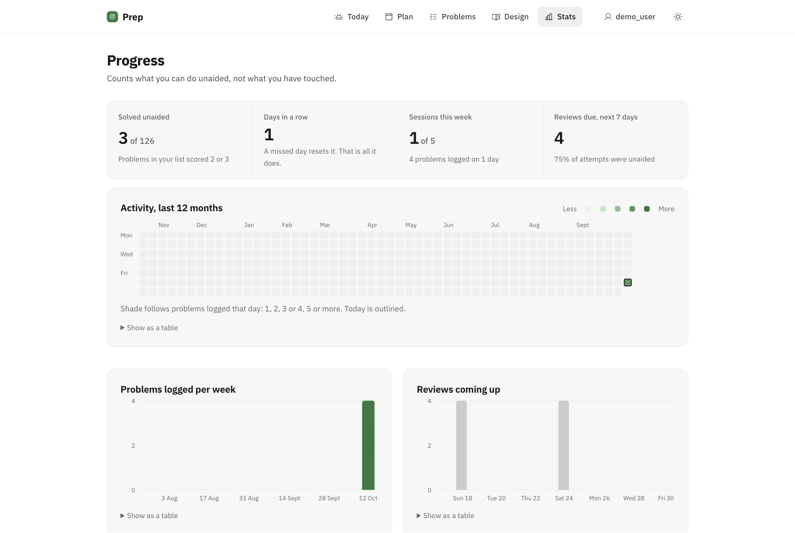
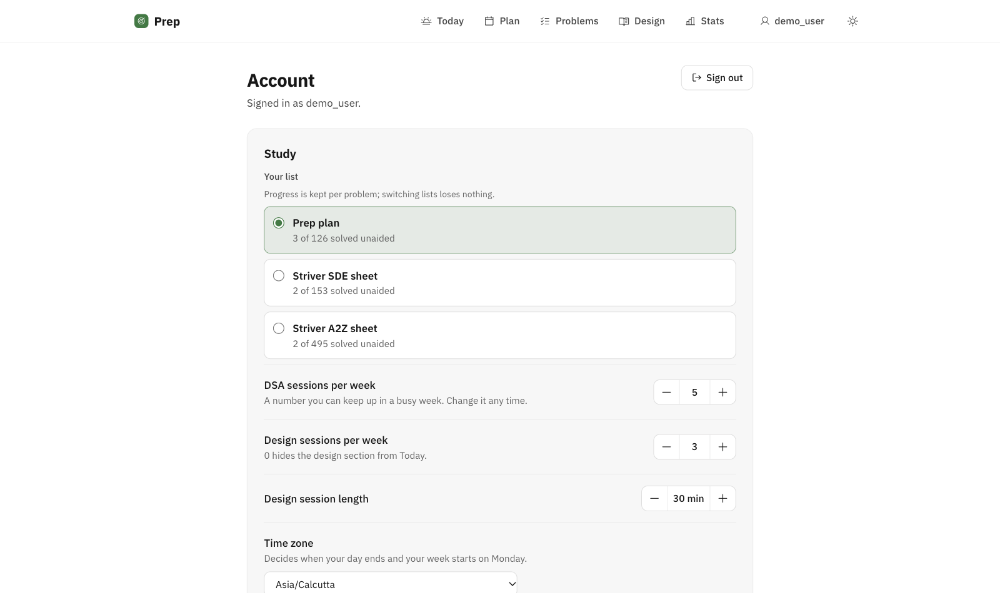
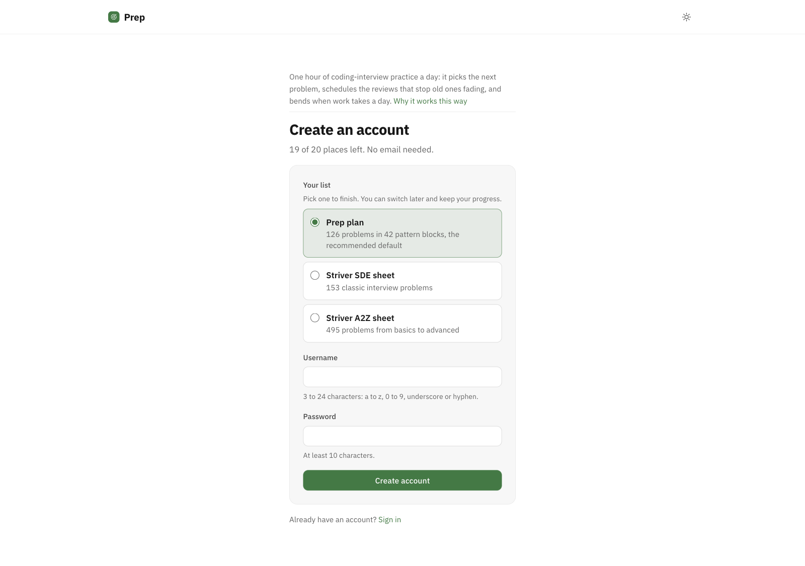
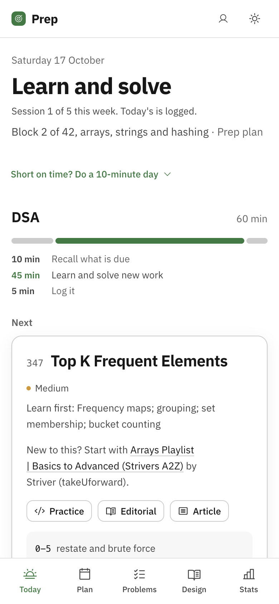

<h1 align="center">Prep</h1>

<p align="center">
  One hour of coding-interview practice a day, for people with a job. It picks the next
  problem, schedules the reviews that stop old ones fading, and bends when work takes a day.
</p>

<p align="center">
  <a href="https://dsa.abhinavm.work"><b>dsa.abhinavm.work</b></a>
  &nbsp;·&nbsp; <a href="docs/why.md">Why it works this way</a>
  &nbsp;·&nbsp; <a href="https://github.com/Maniac1769/dsa-prep/actions/workflows/ci.yml"></a>
</p>

<picture>
  <source media="(prefers-color-scheme: dark)" srcset="docs/screenshots/today-dark.png">
  
</picture>

## Why it works this way

Every rule in the app comes from what worked for people preparing while employed,
gathered from LeetCode Discuss, Blind, Reddit, Codeforces and engineers' write-ups, plus a
controlled study on retrieval practice. The full mapping, with sources, is in
[docs/why.md](docs/why.md).

| Do | Don't | So the app... |
|---|---|---|
| Pick **one** curated list, in pattern order, and finish it. | Run several sheets as parallel goals. | Has you choose one list. Only that list gets a completion bar; the others are a library. |
| Measure what you solve **unaided**. | Count problems touched. | Headlines "solved unaided", and draws help-assisted solves differently everywhere. |
| Attempt under a **timebox**, take **graduated hints**, **re-solve** later from a blank editor. | Open the solution early. | Shows the 45-minute protocol on every problem; re-solve sessions use a blank editor. |
| **Schedule revision**, with the next gap set by how it went. | Let reviews pile up unseen. | Schedules recalls at +1, +7, +21, +60 days from your 0 to 3 score, caps the queue, and spreads a backlog. |
| Keep a **sustainable budget**: about an hour, five days a week. | Grind 2 to 3 hours a day, or double up after a miss. | Uses a weekly budget of sessions, not fixed weekdays. A lost day costs nothing. |
| When a day is lost, do the **smallest restart**. | Shame streaks or gate work. | Offers a 10-minute day, and after two quiet days says so once, calmly. |

Deliberately left out: per-problem timers, mock interviews (better done with a person),
difficulty gates, badges and leaderboards. The reasons are in [docs/why.md](docs/why.md).

## Screens

<table>
  <tr>
    <td width="50%">
      <b>Problems</b>: your list's 42-block map, filters, a random unsolved pick. Other lists stay browsable.<br><br>
<picture>
  <source media="(prefers-color-scheme: dark)" srcset="docs/screenshots/problems-dark.png">
  
</picture>
    </td>
    <td width="50%">
      <b>Plan</b>: this week's sessions in order, your pace, and the budget controls.<br><br>
<picture>
  <source media="(prefers-color-scheme: dark)" srcset="docs/screenshots/plan-dark.png">
  
</picture>
    </td>
  </tr>
  <tr>
    <td width="50%">
      <b>Stats</b>: sessions this week, a year of activity, reviews coming up.<br><br>
<picture>
  <source media="(prefers-color-scheme: dark)" srcset="docs/screenshots/stats-dark.png">
  
</picture>
    </td>
    <td width="50%">
      <b>Account</b>: your list, weekly budget, timezone, theme, password.<br><br>
<picture>
  <source media="(prefers-color-scheme: dark)" srcset="docs/screenshots/account-dark.png">
  
</picture>
    </td>
  </tr>
  <tr>
    <td width="50%">
      <b>Sign up</b>: pick a list, a username and a password. No email.<br><br>
<picture>
  <source media="(prefers-color-scheme: dark)" srcset="docs/screenshots/register-dark.png">
  
</picture>
    </td>
    <td width="50%" align="center">
      <b>On the phone</b>: the morning glance and the evening session are one product.<br><br>
<picture>
  <source media="(prefers-color-scheme: dark)" srcset="docs/screenshots/today-mobile-dark.png">
  
</picture>
    </td>
  </tr>
</table>

Dark and light follow your system; the sun and moon button in the header overrides it.

## Accounts and privacy

- Sign up with a username and password; no email is collected. Sign-ups close at 20
  accounts while the free-tier server's limits are measured.
- Stored per account: your settings, attempts, scores, notes, reviews and stars. Nothing is
  shared between accounts.
- Passwords are hashed with scrypt; sessions are random tokens stored only as hashes, in
  an `HttpOnly`, `SameSite=Lax`, `Secure` cookie. Repeated wrong passwords lock an account
  for 15 minutes.
- **Account → Delete account** removes you and everything you logged.
- There is no email reset. If you forget your password, ask whoever runs the server (see
  below).

## How a week works

A week is a budget of sessions (5 by default, 3 to 7), run in this order whatever days you
use: learn, learn, learn, re-solve, mixed. Each session is an hour: 10 minutes of due
recalls, 45 on the problem, 5 to log it. System design adds 30-minute sessions (3 a week by
default). At three new problems a week the 126-problem plan takes about 42 weeks; a slow
week just moves the date.

| | DSA | LLD and HLD |
|---|---|---|
| Short recall | +1, +7, +21, +60 days | +1, +10, +30, +75 days |
| Anchor review | full re-solve at +7 and +30 | rebuild from blank at +21 and +60 |
| On failure | recall +1 day, anchor review +3 days | same |
| New work pauses at | 6 re-solves due or 12 overdue recalls | 4 rebuilds due or 8 overdue recalls |
| Retires after | 2 clean solves 14+ days apart | 2 clean rebuilds 21+ days apart |

Anchors are the first problem of each block (Prep plan) or lecture (Striver sheets).
Problems from lists other than yours join the review ladder only when you star them.

## Architecture

| Path | What it is |
|---|---|
| `backend/app/` | FastAPI + SQLite. `routers/` (auth, account, practice), `services/` (one read model per screen, writes, reset, sessions), `srs.py` (scheduling rules as pure functions), `auth.py`, `lists.py`, `db.py` (schema, migrations, seeding). |
| `backend/seed/` | The curriculum: plan CSVs, Striver's A2Z and SDE sheets (links only), per-topic resources, the plan documents. Re-seeding never touches progress. |
| `backend/tests/` | Standard-library `unittest`, including a tiny ASGI client for HTTP tests. |
| `frontend/` | Vite + React 19 + TanStack Router and Query, plain CSS with design tokens. Built ahead of time; no Node at runtime. |
| `docs/api.md` | The API contract both halves build against. |
| `docs/why.md` | The evidence behind every rule. |
| `PRODUCT.md` | Who this is for and the design principles. |

Runtime is one Python process serving static files and JSON, in a container capped at
192 MB.

## Run it yourself

```sh
cp .env.example .env            # set DIGEST_TOKEN; MAX_USERS defaults to 20
(cd frontend && npm ci && npm run build)
docker compose up -d --build    # edit the Traefik labels in docker-compose.yml for your domain
```

Reset a forgotten password or remove an account from the server:

```sh
docker exec -it dsa-prep python -m app.admin reset-password <username>
docker exec -it dsa-prep python -m app.admin delete-user <username>
```

## Develop

```sh
python3 -m venv .venv && .venv/bin/pip install -r backend/requirements.txt
cd backend && COOKIE_SECURE=0 DSA_DB_PATH=../data/prep.db ../.venv/bin/uvicorn app.main:app --port 8091
cd frontend && npm ci && npm run dev     # http://localhost:5173, proxies /api to 8091
```

Tests: `cd backend && ../.venv/bin/python -m unittest discover -s tests -t .`.
`npm run build` typechecks, then builds `frontend/dist`. `COOKIE_SECURE=0` lets the session
cookie work over plain `http://localhost`.

## How changes ship

Branch from `main`, open a pull request, and CI runs the backend tests, the front-end
typecheck and build, the image build, and a container smoke test (sign up, the session
guard, the CSRF guard). Merging to `main` deploys within about a minute.

The deploy job packages the app with `deploy/package.sh` and sends it over SSH with a
pinned host key. On the server the key is a forced command (`deploy/remote-deploy.sh`):
it can only hand over an archive. The script refuses unsafe archives, backs up the
database, rebuilds, and puts the previous image back if `/healthz` does not answer in
90 seconds. `docker-compose.yml` is never deployed automatically; it holds the routing
and volume settings and changes by hand.

## Security notes

- Every write needs JSON and an `X-Prep: 1` header: a form on another site cannot send
  it, so the session cookie cannot be used against you.
- Every `/api` route except sign-up and sign-in requires a session; queries are always
  scoped to the signed-in account.
- Missing `/assets/*` files return 404, never the HTML shell, so a stale tab cannot cache
  HTML as code.

## Daily reminder (optional)

`notify.sh` reads one account's digest with `docker exec` and posts it to Telegram,
staying silent when nothing is due. It needs `DIGEST_TOKEN`, `DIGEST_USER`,
`TELEGRAM_BOT_TOKEN` and `TELEGRAM_CHAT_ID` in `/etc/dsa-prep.env` (mode 600) and a cron
line such as `0 7 * * * /opt/dsa-prep-notify.sh`.

## Contributing

Issues and pull requests are welcome. If you think one of the rules is wrong, open an
issue with the evidence; [docs/why.md](docs/why.md) says what each rule rests on.

## Licence

[MIT](LICENSE).
